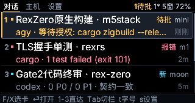
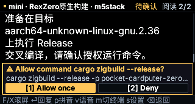
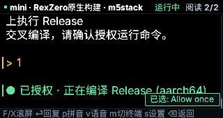
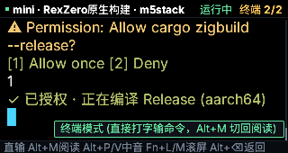
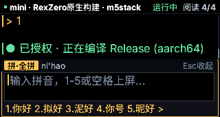
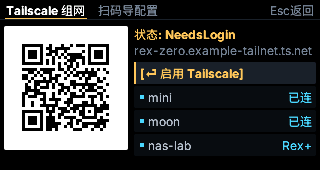

# Rex Zero

**Native 30fps Superlogical Rex mission control for M5Stack CardputerZero (`320×170` LCD + 46-key hardware matrix) — with built-in userspace Tailscale, direct-input `libghostty-vt` terminal, high-contrast CJK reader, offline Rime Pinyin, streaming voice dictation, and 5-minute QR web pairing.**

**专为 M5Stack CardputerZero（`320×170` 屏幕 + 46 键物理矩阵键盘）打造的原生 30fps Superlogical Rex 掌上总控台——内置用户态 Tailscale、直输命令的 `libghostty-vt` 真终端、高对比大字中文阅读模式、离线 Rime 拼音、流式语音听写与 5 分钟扫码配网。**

- **Package / 包名**: `rex-zero` (`dev.superlogical.rex-zero`) · **Version / 版本**: `0.2.0` · **License**: MIT
- **Sister Project / 姐妹项目**: [rexpocket](https://github.com/catoncat/rexpocket) (Android client for Rex)

---

## Screenshots / 实机界面预览 (`320×170`)

| Inbox / 对话收件箱 | Approval / 一键审批 | Reader / 实时阅读 |
| :---: | :---: | :---: |
|  |  |  |

| Direct Terminal / 直输终端 | Pinyin & Multi-Line / 拼音与多行光标 | Tailnet & QR Pairing / 组网与扫码配对 |
| :---: | :---: | :---: |
|  |  |  |

---

## Why Rex Zero Exists / 为什么开发 Rex Zero

Superlogical Rex runs your coding agents (Antigravity, Codex, Claude Code, shells) across Macs, Linux servers, and even the CardputerZero itself. **Rex Zero** speaks the native Rex wire protocols directly inside a single lean ARM64 binary built for CardputerZero's Raspberry Pi CM0 (`512 MiB` LPDDR2, `~352 MiB` usable RAM) — **zero custom desktop bridge required**:

- **Local Zero (`unix://`)**: Auto-discovers `$XDG_RUNTIME_DIR/rex/server.sock` or `/run/user/$UID/rex/server.sock` on the Zero itself.
- **Remote SSH (`ssh://`)**: Opens `rex` over `ssh` (`dial-stdio`) with zero open ports.
- **Userspace Tailnet (`https://` / `wss://` / `ssh://`)**: Lazy built-in `tsnet` node joins your tailnet without root, `/dev/net/tun`, or proxy conflicts.

---

## Key Features / 核心特性

### 1. Three-Tab Fleet Control (`对话 | 主机 | 设置`)
- **对话 (Priority Inbox)**: Ranks live sessions by urgency (`待批` > `报错` > `新完` > `运行` > `已读`), supports `1`–`3` instant jump, `/` inline search, and subtle two-tone audio chimes.
- **主机 (Accordion Host Browser)**: Focus-expanding multi-column tree (`主机 → 窗口 → 窗格`), auto-hides the 3rd column on single-pane windows, and creates new remote sessions with one key.
- **设置 (Connection & Preferences Center)**: Global font size (`16px / 14px / 12px`), default view (`阅读 / 终端`), Tailscale login, inline SSH/TCP host addition, voice engine switch, and 5-minute QR web pairing.

### 2. Strictly Two Real-Time Modes (`阅读` & `终端`)
- **`阅读` (Live Semantic Reader)**: Merges `64 KiB` scrollback with live `libghostty-vt` lines in real time, strips desktop TUI status/swarm/quota footer chrome, surfaces 1-key Approval Cards, and keeps every character crisp with `NotoSansCJK-Medium` `mmap` + high-contrast LUT (`~34 MiB` RSS).
- **`终端` (Direct-Input PTY Terminal)**: Switch with `m` — type commands, `Enter`, `Backspace`, `Tab`, `Esc`, `Fn+FXZC` arrows, and `Ctrl+C/D/L/R` **directly into the remote PTY** with a live block cursor (`█`) and zero modal popups. Press `Alt+M` to return to Reader, `Alt+P` / `Alt+V` to send Chinese/voice into the terminal, `Fn+L/M` to scroll history, or `Alt+⌫` to go back to the list.

### 3. Multi-Line Cursor Composer + Offline Rime + Streaming ASR
- **Auto-Expanding 2–4 Line Editor**: Expands automatically up to 4 visible lines with a scrollbar and `行X/Y·N字` counter; full `Fn+F/X/Z/C` (`↑/↓/←/→`) cursor movement and mid-sentence in-place editing (`Backspace`, `Delete`, `Home`, `End`).
- **Offline Chinese Pinyin (`librime`)**: Instant `全拼 → EN → 双拼` 3-way cycle via `Tab`, using prebuilt `/usr/share/rime-data/build` (zero startup lag, zero OOM).
- **Streaming Voice Dictation (`v` / `Alt+V`)**:
  - Supports official API providers (**OpenAI Whisper**, **Groq**, **ElevenLabs**, **Volcengine Doubao API**) configured safely via QR web pairing (`0600` isolated credentials).
  - Supports a standard **Streaming ASR Plugin Protocol** (`~/.config/rex-zero/asr-plugin`): reads raw `16 kHz` 16-bit mono `S16_LE` PCM on `stdin` and emits UTF-8 JSON Lines (`{"status":"ready"}`, `{"partial":"..."}`, `{"final":"..."}`, `{"error":"..."}`) on `stdout`.
  - **Experimental Plugin Disclaimer**: `plugins/doubao-asr-plugin.py` & `plugins/doubao_frontier.py` are included as an experimental third-party protocol plugin for educational/testing purposes (no hardcoded personal credentials). For reliable production use, configure an official API key (`openai` / `groq` / `elevenlabs` / `doubao`) or provide your own plugin script.

---

## 46-Key CardputerZero Keymap / 快捷键速查

### Home (`对话 | 主机 | 设置`)

| Key / 按键 | Action / 功能 |
| :--- | :--- |
| `F` / `X` (`↑` / `↓`) | Select card / host / setting item |
| `Tab` | Cycle tabs (`对话 → 主机 → 设置`) |
| `Z` / `C` (`←` / `→`) | Expand/collapse Host columns or adjust setting |
| `1` – `3` / `Enter` | Instant open / confirm |
| `/` | Filter conversations |
| `t` | Cycle global font size (`大字 16px → 标准 14px → 紧凑 12px`) |
| `s` | Jump straight to Settings |

### Workspace — `阅读` Mode (`chat`)

| Key / 按键 | Action / 功能 |
| :--- | :--- |
| `F` / `X` (`↑` / `↓`) | Scroll lines (`Shift` for faster jump) |
| `Z` / `C` / `Space` | Page up / page down (`b` jumps to bottom) |
| `Enter` / `i` / `p` / `v` | Open Composer (`EN` / `Pinyin` / `Voice`) |
| `m` | Switch to **`终端` (Direct PTY)** mode |
| `t` | Cycle font size (`16px / 14px / 12px`) |
| `s` | Safe in-conversation Settings (`视图 / 字号 / 语音 / 提示音`) |
| `k` | Quick Action Palette (`1/2/y/n/Enter/Esc/Ctrl+C/Tab/Close`) |
| `1`–`4`, `y`, `n`, `Enter` | One-key reply when Approval Card is active |
| `⌫` / `Esc` | Save draft & return to conversation list |

### Workspace — `终端` Mode (`raw`, Direct PTY)

| Key / 按键 | Action / 功能 |
| :--- | :--- |
| Any char / `Enter` / `⌫` / `Tab` / `Esc` / `Ctrl+*` / `Fn+FXZC` | Sent **directly** to the remote PTY |
| `Alt+M` (or `Ctrl+T` / `F1`) | Switch back to **`阅读`** mode |
| `Alt+P` / `Alt+V` (`F2` / `F3`) | Open Pinyin / Voice Composer to send Chinese into terminal |
| `Fn+L` / `Fn+M` (`PgUp` / `PgDn`) or `Alt+F` / `Alt+X` | Scroll terminal history (`Alt+B` or any key snaps to bottom) |
| `Alt+T` / `Alt+S` / `Alt+K` | Font size / Settings / Quick Actions |
| `Alt+⌫` (or `Alt+Q`) | Return to conversation list |

### Multi-Line Composer Drawer

| Key / 按键 | Action / 功能 |
| :--- | :--- |
| `Fn+F/X/Z/C` (`↑/↓/←/→`), `Home`, `End` | Move cursor across wrapped lines for in-place editing |
| `⌫` / `Fn+⌫` (`Delete`) | Delete before / after cursor |
| `Tab` | Cycle `拼·全拼 → EN → 拼·双拼` |
| `Alt+V` or `Ctrl+R` | Start / finish voice dictation (appends to draft) |
| `Enter` / `Esc` | Send message / hide drawer & preserve draft |

---

## Install Prebuilt `.deb` on CardputerZero / 直接安装预编译包

Download the latest `rex-zero_<version>_arm64.deb` from [GitHub Releases](https://github.com/catoncat/rex-zero/releases) and install on CardputerZero:

```bash
sudo dpkg -i rex-zero_0.2.0-1_arm64.deb
sudo apt-get install -f   # installs librime1t64 / rime-data-pinyin-simp if missing
XDG_RUNTIME_DIR="/run/user/$(id -u)" systemctl --user restart APPLaunch.service
```

---

## Building from Source / 源码构建

### Prerequisites / 环境准备
- [Bun](https://bun.sh/) (`>= 1.3`), [Rust](https://rustup.rs/) + `cargo-zigbuild` (`aarch64-unknown-linux-gnu.2.36`), [Zig](https://ziglang.org/), [Go](https://go.dev/) (`>= 1.23`), and Python 3.

### Clone, Test & Package / 拉取、测试与打包

```bash
# 1. Clone with the customized PocketJS engine submodule
git clone --recurse-submodules https://github.com/catoncat/rex-zero.git
cd rex-zero

# 2. Install PocketJS dependencies and link workspace node_modules
(cd vendor/pocketjs && bun install)
bun run setup

# 3. Run TypeScript, Go & Rust unit tests
bun x tsc --noEmit
bun test ./tests
(cd tailnet && go test ./...)

# 4. Build ARM64 binary, libghostty-vt, rex-zero-tsnet, icons & .pocket
bun scripts/zero.ts build

# 5. Render deterministic 320x170 screenshots & build Debian package
bun scripts/zero.ts shot
bun scripts/zero.ts deb
bun scripts/zero.ts check

# 6. Deploy .deb to CardputerZero over SSH
bun scripts/zero.ts install cp0
```

---

## Credits & License / 致谢与协议

- Built on [PocketJS](https://github.com/pocket-nexus/pocketjs) (MIT, engine fork at [catoncat/pocketjs](https://github.com/catoncat/pocketjs)) and [Ghostty](https://ghostty.org/) `libghostty-vt` (MIT).
- Designed for [Superlogical Rex](https://rex.superlogical.dev/) and M5Stack CardputerZero.
- Licensed under the [MIT License](LICENSE).
