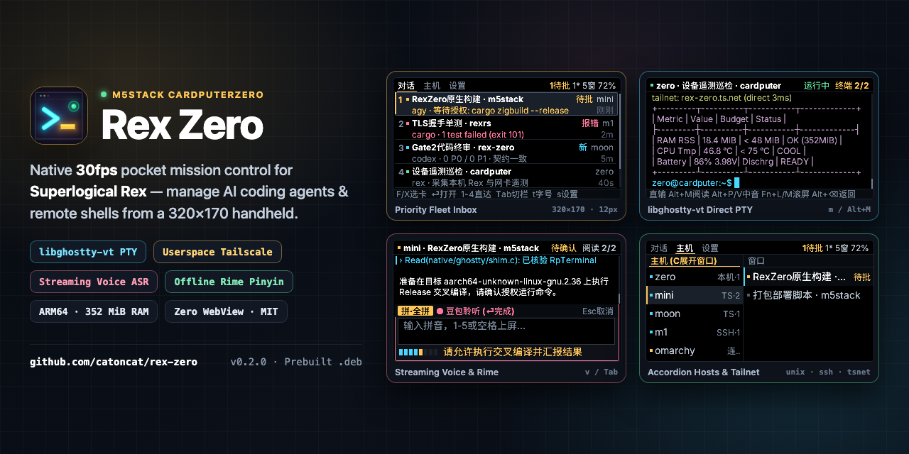
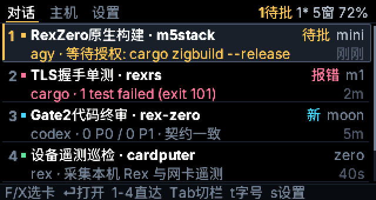
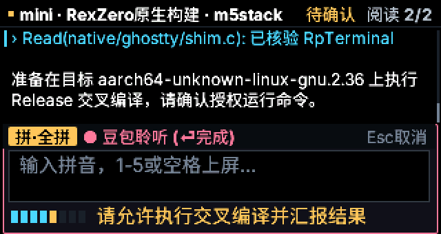
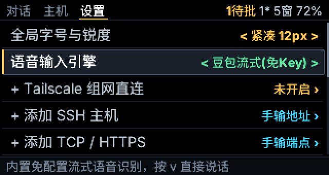

<p align="center">
  
</p>

<h1 align="center">Rex Zero</h1>

<p align="center">
  <strong>Native 30fps <a href="https://rex.superlogical.dev/">Superlogical Rex</a> mission control for M5Stack CardputerZero</strong><br />
  <code>320×170</code> LCD · 46-key hardware matrix · <code>libghostty-vt</code> · userspace Tailscale · offline Rime Pinyin · streaming voice ASR
</p>

<p align="center">
  <strong>English</strong> · <a href="README.zh-CN.md">简体中文</a>
</p>

<p align="center">
  <a href="https://github.com/catoncat/rex-zero/releases"></a>
  <a href="LICENSE"></a>
  
  
</p>

---

## Why Rex Zero?

[Superlogical Rex](https://rex.superlogical.dev/) runs your coding agents (Antigravity, Codex, Claude Code, shells) across Macs, Linux servers, and even the CardputerZero itself. **Rex Zero** speaks the native Rex wire protocols directly inside a single lean ARM64 binary built for CardputerZero's Raspberry Pi CM0 (`512 MiB` LPDDR2, `~352 MiB` usable RAM) — **no WebView, no Electron, no custom desktop bridge required**:

- **Local Zero (`unix://`)**: Auto-discovers `$XDG_RUNTIME_DIR/rex/server.sock` or `/run/user/$UID/rex/server.sock` on the Zero itself.
- **Remote SSH (`ssh://`)**: Opens `rex` over `ssh` (`dial-stdio`) with zero open ports.
- **Userspace Tailnet (`https://` / `wss://` / `ssh://`)**: Lazy built-in `tsnet` node joins your tailnet without root, `/dev/net/tun`, or proxy conflicts.

---

## Interface Gallery (`320×170` Native Render, 2× Crisp Preview)

| Priority Inbox & Recent Tasks | Accordion Host Browser | MRU Quick Switcher |
| :---: | :---: | :---: |
|  |  |  |

| Live Reader & 1-Key Approval | `libghostty-vt` Direct PTY Terminal | Streaming Voice Dictation |
| :---: | :---: | :---: |
|  |  |  |

| Multi-Line Cursor & Offline Rime | Settings & Connection Center | Userspace Tailscale & QR Pairing |
| :---: | :---: | :---: |
|  |  |  |

---

## Key Features

### 1. Three-Tab Fleet Control (`Inbox | Hosts | Settings`)
- **Priority Inbox**: Ranks live sessions by urgency (`Blocked` > `Error` > `Unseen Done` > `Running` > `Idle`), supports `1`–`4` instant jump, `/` inline search, `` ` `` / `Ctrl+Tab` MRU quick switcher, and subtle two-tone audio chimes.
- **Accordion Host Browser**: Focus-expanding multi-column tree (`Hosts → Windows → Split Panes`), automatically collapses unused columns on single-pane windows, and creates new remote sessions with one key.
- **Settings & Multi-Connection Center**: Global font scaling (`16px / 14px / 12px`), default view (`Reader / Terminal`), Tailscale login, inline SSH / TCP host addition, pluggable voice engine switch, and 5-minute QR web pairing.

### 2. Two Real-Time Modes (`Reader` & `Terminal`)
- **Live Semantic Reader**: Merges `64 KiB` scrollback with live `libghostty-vt` lines in real time, strips desktop TUI footer/swarm/quota chrome, surfaces 1-key Approval Cards, and renders crisp CJK text via `mmap`'d `NotoSansCJK` + high-contrast LUT (`~34 MiB` RSS).
- **Direct-Input PTY Terminal**: Switch with `m` — type commands, `Enter`, `Backspace`, `Tab`, `Esc`, `Fn+FXZC` arrows, and `Ctrl+C/D/L/R` **directly into the remote PTY** with a live block cursor (`█`) and zero modal popups. Press `Alt+M` to return to Reader, `Alt+P` / `Alt+V` to compose CJK/voice into the terminal, `Fn+L/M` to scroll history, or `Alt+⌫` to return to the inbox.

### 3. Multi-Line Cursor Composer + Offline Rime + Streaming Voice ASR
- **Auto-Expanding 2–4 Line Editor**: Expands automatically up to 4 visible lines with a scrollbar and `Row X/Y · N chars` counter; full `Fn+F/X/Z/C` (`↑/↓/←/→`) cursor navigation and mid-sentence in-place editing (`Backspace`, `Delete`, `Home`, `End`).
- **Offline Chinese Pinyin (`librime`)**: Instant `Full Pinyin → EN → Double Pinyin` 3-way cycle via `Tab`, backed by prebuilt `/usr/share/rime-data/build` (zero startup lag, zero OOM).
- **Streaming Voice Dictation (`v` / `Alt+V`)**:
  - Official API providers (**OpenAI Whisper**, **Groq**, **ElevenLabs**, **Volcengine Doubao API**) configured safely via 5-minute QR web pairing (`0600` isolated credentials).
  - Open **Streaming ASR Plugin Protocol** (`~/.config/rex-zero/asr-plugin`): reads raw `16 kHz` 16-bit mono `S16_LE` PCM on `stdin` and emits UTF-8 JSON Lines (`{"status":"ready"}`, `{"partial":"..."}`, `{"final":"..."}`, `{"error":"..."}`) on `stdout`.
  - *Experimental Plugin Notice*: `plugins/doubao-asr-plugin.py` and `plugins/doubao_frontier.py` are bundled as an experimental third-party protocol plugin for educational/testing use (zero hardcoded credentials). For production reliability, configure an official API provider or supply your own plugin script.

---

## 46-Key CardputerZero Keymap

### Home (`Inbox | Hosts | Settings`)

| Key | Action |
| :--- | :--- |
| `F` / `X` (`↑` / `↓`) | Move selection |
| `Tab` | Cycle tabs (`Inbox → Hosts → Settings`) |
| `Z` / `C` (`←` / `→`) | Expand/collapse Host columns or adjust setting |
| `1` – `4` / `Enter` | Instant open / confirm |
| `/` / `` ` `` | Filter conversations / MRU quick switcher |
| `t` / `s` / `g` | Cycle global font (`16px / 14px / 12px`) / Settings / Tailnet & QR |

### Workspace — Reader Mode

| Key | Action |
| :--- | :--- |
| `F` / `X` (`↑` / `↓`) | Scroll lines (`Shift` for faster jump) |
| `Z` / `C` / `Space` | Page up / page down (`b` jumps to bottom) |
| `Enter` / `i` / `p` / `v` | Open Composer (`EN` / `Pinyin` / `Voice`) |
| `m` | Switch to **Direct PTY Terminal** mode |
| `t` / `s` / `k` | Font size / Safe in-conversation Settings / Quick Key Palette |
| `1`–`4`, `y`, `n`, `Enter` | One-key reply when Approval Card is active |
| `⌫` / `Esc` | Save draft & return to inbox |

### Workspace — Direct PTY Terminal Mode

| Key | Action |
| :--- | :--- |
| Any char / `Enter` / `⌫` / `Tab` / `Esc` / `Ctrl+*` / `Fn+FXZC` | Sent **directly** to the remote PTY |
| `Alt+M` (or `Ctrl+T` / `F1`) | Switch back to **Reader** mode |
| `Alt+P` / `Alt+V` (`F2` / `F3`) | Open Pinyin / Voice Composer to send CJK/voice into PTY |
| `Fn+L` / `Fn+M` (`PgUp` / `PgDn`) or `Alt+F` / `Alt+X` | Scroll terminal history (`Alt+B` or any key snaps to bottom) |
| `Ctrl+Tab` / `Alt+T` / `Alt+S` / `Alt+K` | MRU Quick Switcher / Font size / Settings / Quick Actions |
| `Alt+⌫` (or `Alt+Q`) | Return to inbox |

### Multi-Line Composer Drawer

| Key | Action |
| :--- | :--- |
| `Fn+F/X/Z/C` (`↑/↓/←/→`), `Home`, `End` | Move cursor across wrapped lines for in-place editing |
| `⌫` / `Fn+⌫` (`Delete`) | Delete before / after cursor |
| `Tab` | Cycle `Full Pinyin → EN → Double Pinyin` |
| `Alt+V` or `Ctrl+R` | Start / finish voice dictation (appends to draft) |
| `Enter` / `Esc` | Send message / hide drawer & preserve draft |

---

## Install Prebuilt `.deb` on CardputerZero

Download the latest `rex-zero_<version>_arm64.deb` from [GitHub Releases](https://github.com/catoncat/rex-zero/releases) and install on your CardputerZero:

```bash
sudo dpkg -i rex-zero_0.2.0-1_arm64.deb
sudo apt-get install -f   # installs librime1t64 / rime-data-pinyin-simp if missing
XDG_RUNTIME_DIR="/run/user/$(id -u)" systemctl --user restart APPLaunch.service
```

---

## Building from Source

### Prerequisites
- [Bun](https://bun.sh/) (`>= 1.3`), [Rust](https://rustup.rs/) + `cargo-zigbuild` (`aarch64-unknown-linux-gnu.2.36`), [Zig](https://ziglang.org/), [Go](https://go.dev/) (`>= 1.23`), and Python 3.

### Clone, Test & Package

```bash
# 1. Clone with the customized PocketJS engine submodule
git clone --recurse-submodules https://github.com/catoncat/rex-zero.git
cd rex-zero

# 2. Install PocketJS dependencies and link workspace node_modules
(cd vendor/pocketjs && bun install)
bun run setup

# 3. Run TypeScript, Go & Rust unit tests
bun x tsc --noEmit
bun test ./tests
(cd tailnet && go test ./...)

# 4. Build ARM64 binary, libghostty-vt, rex-zero-tsnet, icons & .pocket
bun scripts/zero.ts build

# 5. Render deterministic screenshots, package .deb & run Store policy checks
bun scripts/zero.ts shot
bun scripts/zero.ts deb
bun scripts/zero.ts check

# 6. Deploy .deb to CardputerZero over SSH
bun scripts/zero.ts install cp0
```

---

## Credits & License

- Built on [PocketJS](https://github.com/pocket-nexus/pocketjs) (MIT, engine fork at [catoncat/pocketjs](https://github.com/catoncat/pocketjs)) and [Ghostty](https://ghostty.org/) `libghostty-vt` (MIT).
- Designed for [Superlogical Rex](https://rex.superlogical.dev/) and M5Stack CardputerZero.
- Licensed under the [MIT License](LICENSE).
