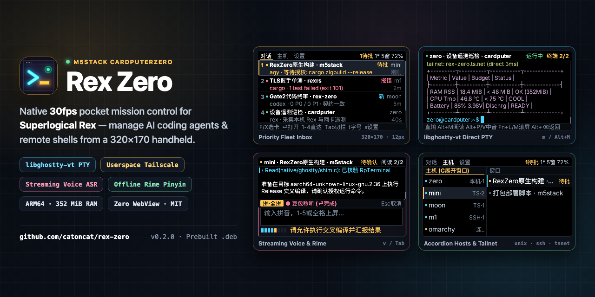
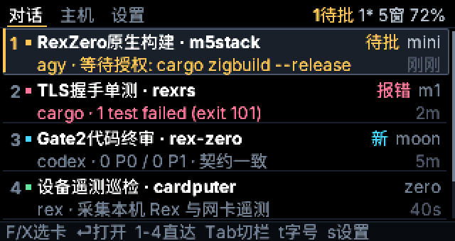
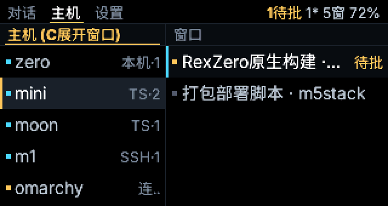
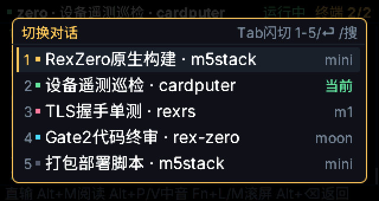
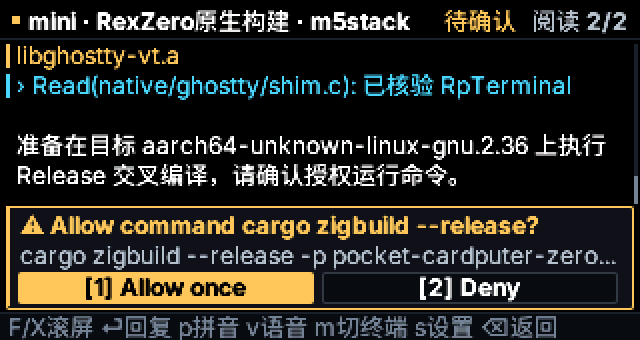
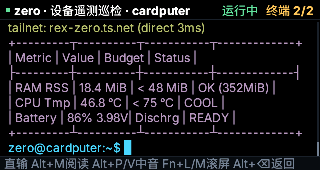
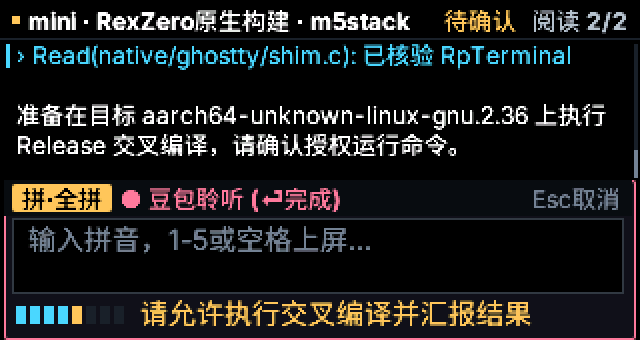
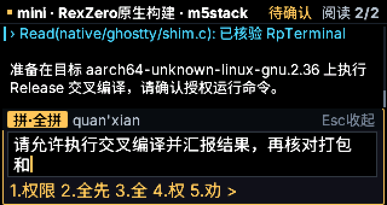
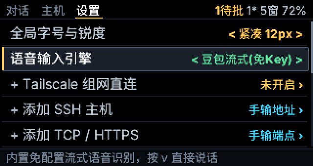
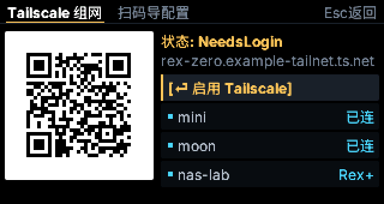

<p align="center">
  
</p>

<h1 align="center">Rex Zero</h1>

<p align="center">
  <strong>专为 M5Stack CardputerZero 打造的原生 30fps <a href="https://rex.superlogical.dev/">Superlogical Rex</a> 掌上总控台</strong><br />
  <code>320×170</code> 屏幕 · 46 键物理键盘 · <code>libghostty-vt</code> 真终端 · 内置用户态 Tailscale · 离线 Rime 拼音 · 流式语音听写
</p>

<p align="center">
  <a href="README.md">English</a> · <strong>简体中文</strong>
</p>

<p align="center">
  <a href="https://github.com/catoncat/rex-zero/releases"></a>
  <a href="LICENSE"></a>
  
  
</p>

---

## 为什么开发 Rex Zero？

[Superlogical Rex](https://rex.superlogical.dev/) 可以把你的 AI 编程 Agent（Antigravity、Codex、Claude Code、终端 Shell）统一运行在 Mac、Linux 服务器甚至 CardputerZero 本机上。**Rex Zero** 针对 CardputerZero 的 Raspberry Pi CM0（`512 MiB` 内存，可用约 `352 MiB`）打造单进程轻量 ARM64 原生客户端——**无 WebView、无 Electron、无需任何桌面自建中转服务**，直接说原生 Rex 协议：

- **本机直连（`unix://`）**：自动发现本机 `$XDG_RUNTIME_DIR/rex/server.sock` 或 `/run/user/$UID/rex/server.sock`。
- **SSH 隧道（`ssh://`）**：基于 `ssh dial-stdio` 直连远端 `rex`，零端口暴露。
- **内置用户态 Tailscale（`tsnet`）**：懒加载用户态组网节点，免 root、免 `/dev/net/tun`、与本机代理零冲突。

---

## 全场景实机界面预览（`320×170` 原生渲染，2× 无损像素呈现）

| 对话收件箱 / 最近任务 | 多机手风琴总览 | 最近任务快切弹窗 |
| :---: | :---: | :---: |
|  |  |  |

| 实时阅读与一键审批 | `libghostty-vt` 直输真终端 | 流式语音输入听写 |
| :---: | :---: | :---: |
|  |  |  |

| 多行光标与离线 Rime 拼音 | 设置与多协议连接中心 | 内置 Tailscale 与扫码配对 |
| :---: | :---: | :---: |
|  |  |  |

---

## 核心特性

### 1. 三栏跨机舰队总控（`对话 | 主机 | 设置`）
- **对话（优先级收件箱）**：按紧急度自动置顶（`待批` > `报错` > `新完` > `运行` > `已读`），支持 `1`–`4` 一键直达、`/` 即时过滤、`` ` `` / `Ctrl+Tab` 最近任务闪切与柔和双音提示音。
- **主机（手风琴式多栏浏览器）**：焦点自动展开 `主机 → 窗口 → 分屏窗格`，单窗格窗口自动隐藏第三栏避免浪费屏幕，支持一键在目标主机新建会话。
- **设置（配置与连接中心）**：支持全局三档字号缩放（`大字 16px / 标准 14px / 紧凑 12px`）、默认视图切换（`阅读 / 终端`）、Tailscale 一键启停、内联手输 SSH/TCP 地址、可插拔语音引擎切换以及 5 分钟手机扫码配网。

### 2. 纯粹双实时模式（`阅读` & `终端`）
- **`阅读`（实时语义阅读模式）**：将 `64 KiB` 历史滚动缓冲与 `libghostty-vt` 实时输出融合展示，自动过滤桌面端 TUI 底部 Swarm/遥测/配额噪点，突出一键审批卡片；基于 `NotoSansCJK` `mmap` 字体与高对比度 LUT，常驻内存仅约 `34 MiB`。
- **`终端`（直输真 PTY 模式）**：按 `m` 瞬切——字符、回车、退格、`Tab`、`Esc`、`Fn+FXZC` 方向键与 `Ctrl+C/D/L/R` **直接透传至远端 PTY**，带实时方块光标（`█`）且零弹窗打断。按 `Alt+M` 切回阅读，按 `Alt+P` / `Alt+V` 呼出拼音/语音输入，按 `Fn+L/M` 翻页回看历史，按 `Alt+⌫` 返回列表。

### 3. 多行光标编辑器 + 离线 Rime 拼音 + 流式语音听写
- **2–4 行自适应多行草稿箱**：内容增多自动扩高至 4 行并显示滚动条与 `行X/Y·N字` 计数；支持 `Fn+F/X/Z/C`（`↑/↓/←/→`）跨行移动光标与句中原位增删。
- **离线中文拼音（`librime`）**：按 `Tab` 在 `全拼 → EN → 双拼` 三态秒切，直接复用预编译 `/usr/share/rime-data/build`（零冷启卡顿、零 OOM）。
- **流式语音听写（`v` / `Alt+V`）**：
  - 支持官方 API 引擎（**OpenAI Whisper**、**Groq**、**ElevenLabs**、**火山豆包 API**），可通过 5 分钟扫码网页安全导入 Key（`0600` 权限隔离存储）。
  - 开放标准 **流式 ASR 插件协议**（`~/.config/rex-zero/asr-plugin`）：`stdin` 输入 `16 kHz` 16-bit 单声道 `S16_LE` PCM，`stdout` 输出 UTF-8 JSON Lines（`{"status":"ready"}`、`{"partial":"..."}`、`{"final":"..."}`、`{"error":"..."}`）。
  - *实验性插件说明*：仓库 `plugins/doubao-asr-plugin.py` 与 `plugins/doubao_frontier.py` 为学习与测试用途的实验性第三方协议插件（不含任何个人密钥）；生产长期稳定使用建议配置上述官方 API 或挂载自定义插件脚本。

---

## 46 键 CardputerZero 快捷键速查

### 主界面（`对话 | 主机 | 设置`）

| 按键 | 功能 |
| :--- | :--- |
| `F` / `X`（`↑` / `↓`） | 上下选择卡片 / 主机 / 设置项 |
| `Tab` | 循环切换栏目（`对话 → 主机 → 设置`） |
| `Z` / `C`（`←` / `→`） | 展开/折叠主机栏，或左右调节设置项 |
| `1` – `4` / `Enter` | 一键直开 / 确认 |
| `/` / `` ` `` | 搜索过滤对话 / 最近任务快切弹窗 |
| `t` / `s` / `g` | 切换全局字号（`16px / 14px / 12px`）/ 直达设置 / Tailscale 组网与扫码 |

### 对话详情 — `阅读` 模式

| 按键 | 功能 |
| :--- | :--- |
| `F` / `X`（`↑` / `↓`） | 上下滚屏（配合 `Shift` 加速） |
| `Z` / `C` / `Space` | 上下翻页（`b` 一键回到底部） |
| `Enter` / `i` / `p` / `v` | 呼出输入框（英文 / 拼音 / 语音听写） |
| `m` | 切换至 **`终端`（直输真 PTY）** 模式 |
| `t` / `s` / `k` | 切换字号 / 安全对话设置 / 快捷按键面板 |
| `1`–`4`、`y`、`n`、`Enter` | 审批卡片激活时一键确认或拒绝 |
| `⌫` / `Esc` | 保存草稿并返回对话列表 |

### 对话详情 — `终端` 模式（直输 PTY）

| 按键 | 功能 |
| :--- | :--- |
| 任意字符 / `Enter` / `⌫` / `Tab` / `Esc` / `Ctrl+*` / `Fn+FXZC` | **直接发送**至远端 PTY |
| `Alt+M`（或 `Ctrl+T` / `F1`） | 切回 **`阅读`** 模式 |
| `Alt+P` / `Alt+V`（`F2` / `F3`） | 呼出拼音 / 语音抽屉向终端发送中文 |
| `Fn+L` / `Fn+M`（`PgUp` / `PgDn`）或 `Alt+F` / `Alt+X` | 滚屏回看终端历史（`Alt+B` 或任意按键自动回底） |
| `Ctrl+Tab` / `Alt+T` / `Alt+S` / `Alt+K` | 最近任务快切 / 字号 / 设置 / 快捷按键 |
| `Alt+⌫`（或 `Alt+Q`） | 返回对话列表 |

### 多行输入抽屉

| 按键 | 功能 |
| :--- | :--- |
| `Fn+F/X/Z/C`（`↑/↓/←/→`）、`Home`、`End` | 跨行移动光标进行句中原位编辑 |
| `⌫` / `Fn+⌫`（`Delete`） | 向左 / 向右删除字符 |
| `Tab` | 切换 `拼·全拼 → EN → 拼·双拼` |
| `Alt+V` 或 `Ctrl+R` | 开始 / 结束语音听写（识别结果自动追加到草稿） |
| `Enter` / `Esc` | 发送消息 / 收起抽屉并保留草稿 |

---

## 直接安装预编译 `.deb` 包

从 [GitHub Releases](https://github.com/catoncat/rex-zero/releases) 下载最新 `rex-zero_<version>_arm64.deb`，拷贝到 CardputerZero 后执行：

```bash
sudo dpkg -i rex-zero_0.2.0-1_arm64.deb
sudo apt-get install -f   # 如缺少 librime1t64 / rime-data-pinyin-simp 会自动补齐
XDG_RUNTIME_DIR="/run/user/$(id -u)" systemctl --user restart APPLaunch.service
```

---

## 从源码构建

### 环境依赖
- [Bun](https://bun.sh/)（`>= 1.3`）、[Rust](https://rustup.rs/) + `cargo-zigbuild`（`aarch64-unknown-linux-gnu.2.36`）、[Zig](https://ziglang.org/)、[Go](https://go.dev/)（`>= 1.23`）以及 Python 3。

### 拉取、测试与打包

```bash
# 1. 拉取仓库及定制版 PocketJS 引擎子模块
git clone --recurse-submodules https://github.com/catoncat/rex-zero.git
cd rex-zero

# 2. 安装 PocketJS 依赖并关联工作区 node_modules
(cd vendor/pocketjs && bun install)
bun run setup

# 3. 运行 TypeScript、Go 与 Rust 单元测试
bun x tsc --noEmit
bun test ./tests
(cd tailnet && go test ./...)

# 4. 交叉编译 ARM64 主程序、libghostty-vt、rex-zero-tsnet、图标与 .pocket 包
bun scripts/zero.ts build

# 5. 自动渲染全场景截图、构建 .deb 并执行官方商店合规检查
bun scripts/zero.ts shot
bun scripts/zero.ts deb
bun scripts/zero.ts check

# 6. 通过 SSH 部署到 CardputerZero
bun scripts/zero.ts install cp0
```

---

## 致谢与开源协议

- 基于 [PocketJS](https://github.com/pocket-nexus/pocketjs)（MIT，引擎分支 [catoncat/pocketjs](https://github.com/catoncat/pocketjs)）与 [Ghostty](https://ghostty.org/) `libghostty-vt`（MIT）构建。
- 面向 [Superlogical Rex](https://rex.superlogical.dev/) 与 M5Stack CardputerZero 设计。
- 本项目采用 [MIT 开源协议](LICENSE)。
